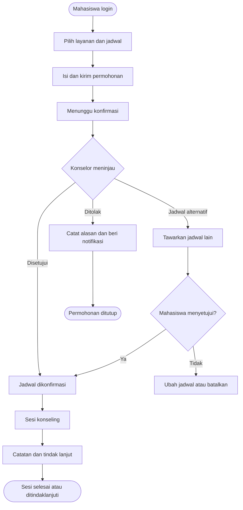

# PROPOSAL SISTEM INFORMASI
## WEBSITE BIMBINGAN DAN KONSELING MAHASISWA

**Dokumen:** Proposal kebutuhan dan rancangan awal sistem  
**Versi:** 1.0  
**Tanggal:** 10 Oktober 2026  
**Status:** Draf untuk ditinjau dan disesuaikan dengan kebijakan institusi

---

## 1. Ringkasan Eksekutif

Website Bimbingan dan Konseling (BK) merupakan sistem informasi berbasis web untuk membantu mahasiswa mengajukan layanan konseling serta membantu guru BK/konselor mengelola permohonan, jadwal, sesi konseling, catatan profesional, dan tindak lanjut. Sistem menyediakan akses berdasarkan peran, pemberitahuan status, serta laporan operasional dengan tetap mengutamakan privasi dan kerahasiaan informasi konseling.

Proposal ini berfokus pada dua peran utama: **Mahasiswa** dan **Guru BK/Konselor**. Peran administrator dapat ditambahkan untuk mengelola akun dan konfigurasi teknis, tetapi tidak otomatis memperoleh akses ke isi catatan konseling.

## 2. Latar Belakang

Mahasiswa dapat menghadapi tantangan akademik, adaptasi lingkungan kampus, pengelolaan waktu, hubungan sosial, maupun persoalan pribadi yang memengaruhi proses belajar. Proses pendaftaran dan pengelolaan konseling secara manual dapat menyulitkan penjadwalan, dokumentasi sesi, pemantauan tindak lanjut, dan penyusunan laporan.

Diperlukan platform terpusat yang memungkinkan mahasiswa mengajukan konsultasi dengan lebih mudah dan membantu konselor mengelola layanan secara tertata, aman, dan dapat dipertanggungjawabkan.

## 3. Tujuan

1. Memudahkan mahasiswa mengajukan konsultasi secara daring.
2. Memudahkan konselor mengelola permohonan, ketersediaan jadwal, sesi, dan tindak lanjut.
3. Menyediakan informasi status permohonan dan pengingat jadwal.
4. Mendukung pencatatan serta pelaporan kegiatan konseling sesuai kewenangan.
5. Menjaga kerahasiaan data melalui pembatasan akses dan audit aktivitas.

## 4. Ruang Lingkup

### 4.1 Termasuk dalam versi awal (MVP)

- Login, logout, dan pengelolaan profil.
- Hak akses berbasis peran.
- Pengelolaan layanan dan jadwal konselor.
- Pengajuan, persetujuan, penolakan, pembatalan, dan penjadwalan ulang.
- Status dan notifikasi permohonan.
- Pencatatan sesi konseling yang dibatasi aksesnya.
- Rencana dan status tindak lanjut.
- Riwayat milik mahasiswa dan riwayat penanganan konselor.
- Statistik operasional agregat dan ekspor laporan dasar.
- Audit aktivitas penting serta pencadangan data.

### 4.2 Di luar ruang lingkup awal (opsional untuk fase berikutnya)

- Chat real-time.
- Video call terintegrasi.
- Integrasi WhatsApp/SMS.
- Integrasi dengan sistem akademik atau single sign-on kampus.
- Penilaian psikologis atau instrumen asesmen khusus.
- Aplikasi mobile native.

Fitur di luar MVP hanya dikembangkan setelah kebutuhan, biaya, risiko, dan persetujuan institusi ditetapkan.

## 5. Pengguna dan Hak Akses

### 5.1 Mahasiswa

Mahasiswa dapat:
- Membuat atau mengaktifkan akun sesuai kebijakan kampus.
- Mengelola informasi profil yang diizinkan.
- Melihat jenis layanan dan informasi konselor.
- Mengajukan konsultasi, memilih metode, serta memilih slot jadwal yang tersedia.
- Melihat status dan jadwal permohonan.
- Membatalkan atau mengajukan perubahan jadwal sesuai aturan.
- Melihat riwayat pengajuan dan jadwal miliknya sendiri.
- Melihat informasi tindak lanjut yang memang ditujukan kepadanya.

Mahasiswa tidak dapat melihat catatan internal konselor atau data mahasiswa lain.

### 5.2 Guru BK/Konselor

Konselor dapat:
- Mengelola profil profesional, jenis layanan, dan ketersediaan jadwal.
- Meninjau permohonan yang menjadi kewenangannya.
- Menyetujui, menolak dengan alasan yang sesuai, atau menawarkan jadwal alternatif.
- Mencatat kehadiran dan pelaksanaan sesi.
- Menyimpan catatan profesional yang bersifat rahasia.
- Menyusun rencana tindak lanjut dan sesi lanjutan.
- Melihat riwayat kasus yang menjadi kewenangannya.
- Menghasilkan laporan operasional sesuai hak akses.

### 5.3 Administrator (opsional)

Administrator dapat mengelola akun, peran, konfigurasi, kategori layanan, dan operasional teknis. Hak administrator tidak dengan sendirinya memberikan akses ke isi catatan konseling. Akses darurat atau khusus, jika dibutuhkan, harus diatur melalui kebijakan resmi dan dicatat dalam audit log.

## 6. Kebutuhan Fungsional

| ID | Fitur | Deskripsi | Pengguna |
|---|---|---|---|
| FR-01 | Autentikasi | Login, logout, reset kata sandi, dan pengelolaan sesi | Semua |
| FR-02 | Profil | Mengelola profil sesuai hak akses | Mahasiswa, Konselor |
| FR-03 | Layanan konseling | Menampilkan kategori, deskripsi, dan metode layanan | Mahasiswa, Konselor |
| FR-04 | Jadwal konselor | Mengatur ketersediaan dan slot waktu | Konselor |
| FR-05 | Pengajuan | Mengirim permohonan beserta topik awal dan preferensi jadwal | Mahasiswa |
| FR-06 | Keputusan permohonan | Menyetujui, menolak, atau menawarkan jadwal alternatif | Konselor |
| FR-07 | Pencegahan bentrok | Mencegah dua permohonan terkonfirmasi pada slot yang sama | Sistem |
| FR-08 | Status dan notifikasi | Memberi tahu perubahan status dan jadwal | Mahasiswa, Konselor |
| FR-09 | Pengelolaan sesi | Mencatat jadwal, kehadiran, dan status sesi | Konselor |
| FR-10 | Catatan konseling | Menyimpan catatan profesional dengan kontrol akses khusus | Konselor berwenang |
| FR-11 | Tindak lanjut | Membuat rencana, tenggat, dan status tindak lanjut | Konselor |
| FR-12 | Riwayat | Menampilkan riwayat sesuai kewenangan pengguna | Mahasiswa, Konselor |
| FR-13 | Laporan | Menyediakan rekap kegiatan dan ekspor laporan dasar | Konselor berwenang, Administrator sesuai kebijakan |
| FR-14 | Audit log | Merekam akses/perubahan penting pada data sensitif | Petugas berwenang |
| FR-15 | Backup dan pemulihan | Mendukung backup terjadwal dan uji pemulihan | Pengelola teknis |

## 7. Kebutuhan Nonfungsional

- **Keamanan:** HTTPS, hash kata sandi yang kuat, validasi input, perlindungan CSRF, pembatasan percobaan login, dan manajemen sesi yang aman.
- **Otorisasi:** pemeriksaan hak akses di sisi server pada setiap permintaan, bukan hanya menyembunyikan menu di antarmuka.
- **Privasi:** minimisasi data, tujuan pemrosesan yang jelas, pembatasan retensi, dan akses berbasis kebutuhan.
- **Auditabilitas:** akses dan perubahan pada data sensitif dicatat tanpa menyalin isi catatan rahasia ke log.
- **Ketersediaan:** backup terjadwal, prosedur pemulihan, dan pemantauan layanan.
- **Kemudahan penggunaan:** antarmuka responsif, navigasi sederhana, label yang jelas, dan pesan kesalahan yang mudah dipahami.
- **Kompatibilitas:** mendukung browser modern pada desktop dan perangkat seluler.
- **Kinerja:** daftar data menggunakan paginasi dan query efisien; target waktu respons disepakati saat analisis teknis.
- **Aksesibilitas:** warna, kontras, fokus keyboard, dan label formulir dirancang agar mudah digunakan.

## 8. Alur Proses Utama

### 8.1 Alur mahasiswa

1. Mahasiswa membuka website dan login.
2. Mahasiswa memilih jenis layanan konseling.
3. Mahasiswa membaca informasi layanan dan memilih konselor/metode jika tersedia.
4. Mahasiswa memilih slot waktu yang tersedia.
5. Mahasiswa mengisi formulir awal dengan informasi minimum yang diperlukan.
6. Sistem memvalidasi data dan menyimpan permohonan dengan status **Menunggu Konfirmasi**.
7. Sistem memberi notifikasi bahwa permohonan telah diterima.
8. Konselor meninjau permohonan dan ketersediaan jadwal.
9. Mahasiswa menerima keputusan atau tawaran jadwal alternatif.
10. Mahasiswa mengikuti sesi sesuai jadwal yang telah disepakati.
11. Konselor mencatat pelaksanaan sesi dan, bila perlu, tindak lanjut.
12. Mahasiswa dapat melihat status serta informasi tindak lanjut yang ditujukan kepadanya.

### 8.2 Alur konselor

1. Konselor login dan membuka dashboard.
2. Konselor memeriksa permohonan baru dan kalender.
3. Konselor meninjau informasi yang relevan.
4. Konselor menyetujui, menolak dengan alasan yang sesuai, atau mengusulkan jadwal lain.
5. Sistem mengirimkan pemberitahuan kepada mahasiswa.
6. Konselor melaksanakan sesi dan mencatat kehadiran.
7. Konselor menambahkan catatan profesional pada ruang yang dibatasi aksesnya.
8. Konselor menentukan apakah kasus selesai atau membutuhkan tindak lanjut.
9. Sistem memperbarui riwayat dan laporan sesuai hak akses.

### 8.3 Diagram alur keputusan

## 9. Status Proses

Status pengajuan yang disarankan:

- **Draft:** formulir belum dikirim.
- **Menunggu Konfirmasi:** permohonan diterima sistem.
- **Disetujui:** jadwal telah dikonfirmasi.
- **Perlu Penjadwalan Ulang:** jadwal awal tidak dapat dipenuhi.
- **Ditolak:** permohonan tidak dapat dilanjutkan.
- **Dibatalkan:** permohonan dibatalkan sesuai aturan.
- **Sedang Berlangsung:** sesi sedang dilakukan.
- **Selesai:** sesi telah dilaksanakan.
- **Tidak Hadir:** mahasiswa tidak hadir sesuai ketentuan.

Status sesi dan status penanganan kasus sebaiknya dipisahkan. Sebagai contoh, sebuah sesi dapat berstatus **Selesai**, sedangkan kasusnya tetap memiliki status tindak lanjut. Status tindak lanjut dapat berupa **Tidak Diperlukan**, **Perlu Tindak Lanjut**, **Terjadwal**, atau **Selesai**.

## 10. Rancangan Halaman

### 10.1 Halaman publik
- Beranda dan informasi layanan.
- Panduan penggunaan.
- Kebijakan privasi dan batas kerahasiaan.
- Informasi kontak layanan dan jalur bantuan darurat yang disahkan institusi.
- Login dan aktivasi akun.

### 10.2 Dashboard mahasiswa
- Ringkasan status permohonan.
- Tombol ajukan konseling.
- Kalender dan jadwal mendatang.
- Notifikasi.
- Riwayat pengajuan.
- Informasi tindak lanjut yang ditujukan kepada mahasiswa.

### 10.3 Dashboard konselor
- Jumlah permohonan baru.
- Jadwal hari ini.
- Kalender ketersediaan.
- Daftar permohonan dan filter status.
- Daftar sesi yang perlu ditindaklanjuti.
- Statistik agregat dan laporan.

### 10.4 Halaman pengelolaan sesi
- Informasi jadwal dan mahasiswa sesuai kebutuhan.
- Status kehadiran.
- Catatan sesi yang terlindungi.
- Rencana tindak lanjut.
- Riwayat perubahan penting.

## 11. Rancangan Database Awal

| Tabel | Tujuan | Kolom penting (contoh) |
|---|---|---|
| `users` | Akun dan autentikasi | `id`, `email`, `password_hash`, `status` |
| `roles` | Daftar peran | `id`, `name` |
| `user_roles` | Relasi pengguna dan peran | `user_id`, `role_id` |
| `students` | Profil mahasiswa | `id`, `user_id`, `student_number`, `program_study` |
| `counselors` | Profil konselor | `id`, `user_id`, `professional_profile`, `status` |
| `counseling_services` | Jenis layanan | `id`, `name`, `description`, `active` |
| `counselor_schedules` | Slot jadwal | `id`, `counselor_id`, `start_at`, `end_at`, `availability_status` |
| `appointments` | Permohonan | `id`, `student_id`, `counselor_id`, `service_id`, `schedule_id`, `status` |
| `counseling_sessions` | Pelaksanaan sesi | `id`, `appointment_id`, `attendance_status`, `started_at`, `ended_at` |
| `counseling_notes` | Catatan rahasia | `id`, `session_id`, `author_id`, `note_encrypted_or_protected`, `created_at` |
| `follow_ups` | Tindak lanjut | `id`, `session_id`, `description`, `due_at`, `status` |
| `notifications` | Pemberitahuan | `id`, `user_id`, `type`, `message_template`, `read_at` |
| `audit_logs` | Jejak aktivitas | `id`, `actor_id`, `action`, `target_type`, `target_id`, `created_at` |

Rancangan di atas merupakan titik awal. Struktur akhir perlu mencakup foreign key, indeks, aturan penghapusan, zona waktu, dan kebijakan retensi. Hindari menaruh isi catatan konseling dalam tabel notifikasi atau log umum. Data sensitif sebaiknya dilindungi dengan kontrol akses ketat dan enkripsi yang sesuai kebutuhan.

## 12. Keamanan, Privasi, dan Etika

1. Terapkan prinsip hak akses minimum dan verifikasi otorisasi di server untuk setiap data.
2. Mahasiswa hanya dapat melihat pengajuan dan informasi miliknya sendiri.
3. Konselor hanya dapat melihat kasus yang ditugaskan atau menjadi kewenangannya.
4. Catatan konseling dipisahkan dari data jadwal dan hanya tersedia untuk konselor yang berwenang.
5. Gunakan HTTPS, hash kata sandi yang kuat, validasi input, perlindungan CSRF/XSS/SQL injection, dan manajemen sesi aman.
6. Terapkan pencatatan akses terhadap data sensitif serta pemantauan aktivitas yang tidak wajar.
7. Tetapkan persetujuan, tujuan pemrosesan, retensi, koreksi, dan penghapusan data berdasarkan kebijakan institusi serta hukum yang berlaku.
8. Jangan memasukkan isi masalah konseling ke email, pesan WhatsApp, atau notifikasi layar kunci.
9. Siapkan prosedur rujukan atau respons darurat yang telah disetujui institusi; website tidak boleh dianggap sebagai layanan respons darurat 24 jam kecuali memang tersedia.
10. Lakukan backup dan uji pemulihan secara berkala.

Implementasi harus ditinjau sesuai peraturan perlindungan data pribadi yang berlaku di Indonesia, kebijakan institusi, dan standar profesi konselor yang relevan.

## 13. Teknologi yang Direkomendasikan

Pilihan awal yang dapat digunakan:

- **Frontend:** HTML, CSS, JavaScript, dan Bootstrap.
- **Backend:** Laravel atau CodeIgniter, dipilih sesuai kemampuan tim dan kebutuhan pemeliharaan.
- **Database:** MySQL/MariaDB atau PostgreSQL.
- **Laporan:** PDF dan Excel.
- **Notifikasi:** notifikasi internal; email dapat ditambahkan setelah konfigurasi keamanan dan persetujuan institusi.
- **Deployment:** server institusi atau cloud yang memenuhi persyaratan keamanan dan ketersediaan.
- **Version control:** Git dengan alur review perubahan kode.

Keputusan teknologi final dibuat setelah analisis kebutuhan, kapasitas tim, dan lingkungan server.

## 14. Tahapan Pengembangan dan Estimasi

| Tahap | Aktivitas | Estimasi awal |
|---|---|---|
| 1. Analisis | Wawancara, kebutuhan, aturan layanan dan privasi | 1 minggu |
| 2. Desain | Alur, wireframe, database, hak akses | 1–2 minggu |
| 3. Pengembangan MVP | Autentikasi, jadwal, permohonan, sesi, tindak lanjut | 3–4 minggu |
| 4. Pengujian | Fungsional, hak akses, keamanan dasar, responsif | 1–2 minggu |
| 5. Uji coba dan pelatihan | Pilot terbatas, dokumentasi, perbaikan | 1 minggu |

**Total estimasi awal: 7–10 minggu**, dengan asumsi ruang lingkup MVP stabil dan tim tersedia. Estimasi bukan komitmen waktu final; integrasi eksternal, migrasi data, dan persyaratan institusi dapat menambah durasi.

## 15. Indikator Keberhasilan

- Mahasiswa dapat mengajukan permohonan secara mandiri.
- Konselor dapat mengelola permohonan dan jadwal dari satu dashboard.
- Sistem mencegah pemesanan ganda pada slot yang sama.
- Pengguna dapat memantau status dan jadwal dengan jelas.
- Catatan sensitif tidak dapat diakses pengguna tanpa kewenangan.
- Laporan operasional dapat dibuat tanpa mengungkap informasi pribadi yang tidak diperlukan.
- Pengguna memberikan umpan balik positif terhadap kemudahan penggunaan.
- Backup dan prosedur pemulihan berhasil diuji.

## 16. Risiko dan Mitigasi

| Risiko | Mitigasi |
|---|---|
| Kebocoran catatan sensitif | Hak akses minimum, enkripsi sesuai kebutuhan, audit, dan pengujian otorisasi |
| Jadwal bentrok | Transaksi database, validasi slot di server, dan penguncian saat konfirmasi |
| Pengguna tidak memahami status | Label status konsisten, panduan, dan notifikasi yang jelas |
| Konselor terlambat merespons | Aturan waktu respons dan dashboard permohonan tertunda |
| Kehilangan data | Backup terjadwal dan uji pemulihan |
| Penggunaan untuk keadaan darurat | Informasi batas layanan dan jalur bantuan resmi yang mudah ditemukan |

## 17. Hal yang Perlu Diputuskan Sebelum Implementasi

1. Apakah pengguna sasaran adalah mahasiswa perguruan tinggi atau siswa sekolah?
2. Apakah istilah peran yang tepat adalah **Guru BK**, **Dosen Pembimbing**, atau **Konselor kampus**?
3. Apakah akun dibuat sendiri, diaktifkan operator, atau terintegrasi dengan sistem akademik?
4. Apakah sesi dilakukan tatap muka, daring, atau keduanya?
5. Apakah mahasiswa dapat memilih konselor atau sistem menetapkan konselor?
6. Siapa yang berwenang melihat catatan, laporan, dan informasi tindak lanjut?
7. Apakah perlu persetujuan khusus, prosedur rujukan, dan retensi data tertentu?
8. Apa teknologi, server, anggaran, dan target peluncuran yang tersedia?

## 18. Penutup

Website Bimbingan dan Konseling diharapkan menjadi sarana yang mempermudah akses layanan, meningkatkan keteraturan administrasi, serta membantu konselor mengelola sesi dan tindak lanjut secara terstruktur. Keberhasilan sistem bergantung pada desain yang mudah digunakan, alur kerja yang disepakati, keamanan teknis, dan kebijakan kerahasiaan yang jelas.

Proposal ini merupakan rancangan awal yang perlu divalidasi bersama pihak institusi, calon pengguna, konselor, pengelola TI, dan penanggung jawab perlindungan data sebelum pengembangan dimulai.
